# Weighted Total Domination under Different Weight Schemes (GNN + Deep RL)

This project shows that our GNN + reinforcement-learning solver for the **minimum vertex-weighted total dominating
set** (wtds-gnn-rl) works across **four realistic ways of assigning vertex weights** and **four graph classes**.
Following the guide's instruction, **the approach and the algorithm are unchanged**: same base paper (Chen, Liu, He
2024), same 3-layer MPNN + Double DQN, same features, mask, degree-1 rule, reward `r = −w(v)/w̄`, redundancy removal
(RR), local search (LS), weighted greedy and ILP baselines. Only three things were added: the weight schemes, the graph
classes, and a short fine-tuning on them, followed by a full ground-truth evaluation.

Every solution shown or reported passes `is_total_dominating_set`, and every weight `W(S)` is recomputed from the
solution and the weights. Every number below comes from a run in this folder (commands in
[Reproducing the results](#reproducing-the-results)); the decisions taken during the build are in
[`docs/decisions.md`](docs/decisions.md).

<!-- RESULTS-AT-A-GLANCE:begin -->
## Results at a glance

* **Validation (160 graphs, 10 per class × scheme, proven optima):** gap after RR, zero-shot → fine-tuned:
  seed 0 5.69% → **4.69%**, seed 1
  6.28% → **5.18%**; weighted greedy + RR
  5.73%. Both seeds: 78,000 fine-tuning steps.
* **Test grid (800 weighted instances, ILP proven on 624/640):** mean gap
  over all classes, schemes and n ∈ {20, 50, 100, 200} — ours + RR 4.51 ± 0.89%,
  weighted greedy + RR 5.51%, the copied wtds model (zero-shot) + RR
  6.02 ± 0.98%; with the same 1 s local search: ours 2.24 ± 0.36%,
  greedy 2.76% (mean ± std over the 2 model seeds).
* **Validity:** 9,440 reported solutions, **100 % valid**; each was re-verified
  from the rebuilt graph and its W(S) recomputed (`scripts/analyze.py`).
* The gain over greedy is **not uniform**: see the findings in Section 7.6 (written from the data).
<!-- RESULTS-AT-A-GLANCE:end -->

## 1. Problem

`G = (V, E)` undirected and simple, vertex weights `w(v) > 0`, `N(v)` = open neighbourhood.

* `S` is a **total dominating set (TDS)** iff every vertex, including those in `S`, has a neighbour in `S`:
  `N(v) ∩ S ≠ ∅` for all `v`. **Goal:** minimise `W(S) = Σ_{v∈S} w(v)`.
* A TDS exists iff there is no isolated vertex; otherwise every solver raises `NoTotalDominatingSetError`.
  User-given weights must be finite and `> 0`, else `InvalidWeightError` names the vertex.
* **Exact ILP:** `min Σ w_v x_v  s.t.  Σ_{u∈N(v)} x_u ≥ 1 ∀v, x ∈ {0,1}` (OR-Tools CP-SAT, time limit, proven-optimal
  flag).

## 2. The four weight-assignment schemes (`wtdsws/weights.py`)

`d(v)` = degree, `Δ` = max degree, `δ` = min degree (≥ 1). All weights are integers in [1, 100] and deterministic given
`(G, seed)`; ceilings are computed in exact integer arithmetic.

| Scheme | Formula | Real-world meaning |
|---|---|---|
| `degree` | `w(v) = ⌈100 · d(v) / Δ⌉` (a max-degree vertex gets 100) | cost grows with the number of neighbours served, e.g. the monitoring load or energy of a busy router or sensor |
| `inverse` | `w(v) = ⌈100 · δ / d(v)⌉` (a min-degree vertex gets 100) | well-connected sites are cheap per neighbour covered (existing infrastructure at hubs), so remote low-degree sites are costly to equip |
| `random` | `w(v) ~ U{1..100}`, seeded RNG (seed recorded per graph) | independent site costs: land, installation, permits |
| `mixed` | `w(v) = round((w_degree + w_inverse + w_random) / 3)`, clipped to [1, 100]; same random draw as `random` | realistic combinations of load and site cost |

```python
from wtdsws import assign_weights, generate_graph, solve
G = generate_graph("chordal", n=80, seed=0)           # networkx graph, class asserted
w = assign_weights(G, scheme="inverse", seed=0)       # {vertex: int weight in [1, 100]}
res = solve(G, w, method="rl", rr=True, ls_time=1.0)  # vertices, weight, size, runtime, is_valid (always verified)
```

## 3. The four graph classes (`wtdsws/graph_classes.py`)

| Class | Subtypes / generator | Isolated-vertex repair (stays in class) |
|---|---|---|
| **ER** | Erdős–Rényi `G(n, p)`, average degree ~ U[3, 15] | attach as a leaf to a random vertex |
| **BA** | Barabási–Albert, `m ∈ {1..8}` (`m = 1`: trees with many leaves, exercises the forced rule) | not needed (BA graphs are connected) |
| **Chordal** | (a) `G(n, p)` completed with `networkx.complete_to_chordal_graph`; (b) random k-trees, `k ∈ {1..4}` (new vertex joined to a random k-clique); (c) unit / proper interval graphs (points on a line, edge iff distance < r) | leaf for (a), (b) (a leaf keeps a graph chordal); re-sample with a 10 % larger `r` for (c) |
| **Bipartite** | (a) random bipartite, `n1 + n2 = n`, edge probability `p`; (b) convex bipartite (each `y ∈ Y` adjacent to a consecutive interval of the ordered side `X`) | edge to a random vertex of the other side for (a); re-sample with longer intervals for (b) |

After generation and any repair the class is **asserted**: `networkx.is_chordal`, `networkx.is_bipartite` (and both
sides respected), a convexity checker for convex bipartite graphs, an exact model check for unit-interval graphs, and
no isolated vertex. The tests do this for 500 graphs per class.

**Why these classes.** Total domination is NP-hard on general bipartite and on chordal graphs (Laskar, Pfaff,
Hedetniemi & Hedetniemi 1984), so a learned heuristic is meaningful there. Some subclasses have exact polynomial
algorithms for weighted domination variants: Lee (2025) studies {k}-domination, k-tuple domination and their total
variants on weighted strongly chordal, chordal bipartite, proper interval and convex bipartite graphs. We do **not**
claim learning is needed on those subclasses; unit-interval and convex-bipartite graphs are reported only as a
sanity check (Section 7.5).

## 4. What changed from wtds-gnn-rl

| | wtds-gnn-rl | this project (wtdsws) |
|---|---|---|
| Algorithm (3-layer MPNN, hidden 64, mean ‖ max readout, Double DQN, mask `gain > 0`, degree-1 rule, RR, LS) | — | **unchanged** (code copied, package renamed) |
| Reward | `r = −w(v)/w̄`, γ = 1 | **unchanged** |
| Node features (10; index 9 = `w(v)/max w`) | — | **unchanged** |
| Weights | uniform 1–100, uniform 1–10, degree + noise | **4 schemes**: degree, inverse, random, mixed |
| Graphs | ER, BA, Watts–Strogatz, geometric, lattices | **4 classes**: ER, BA, chordal (+ k-trees, interval), bipartite (+ convex) |
| Training | fine-tuned from the TDS model | **short fine-tuning** from the copied wtds `best.pt` (same reward and algorithm) |
| Zero weights | weight 0 = free, pre-selected vertex | still supported internally (the copied wtds tests rely on it); **user input must be > 0** |
| Baseline method `old_tds_model` | unweighted TDS checkpoint | replaced by `wtds_zero_shot` = the copied wtds model, not fine-tuned |

<!-- TRAINING:begin -->
## 5. Training: short fine-tuning, not from scratch

Both copied wtds checkpoints load with no missing or unexpected keys (tested). **Zero-shot first:** before any
training they were evaluated on the new validation set (160 graphs = 10 per class × scheme, n = 50–100, optima proven
by CP-SAT in 30 s; 0 of 160 needed replacing). Then each seed was fine-tuned from its own wtds `best.pt` with the
**same reward and algorithm**: lr 5e-5, ε 0.2 → 0.05 over the first 20 % of the step horizon
(90,000), batch 64, a fresh replay buffer of 20,000 transitions
(30k planned; 20k because less than 3 GB of RAM was free), every episode drawing a class uniformly from
{ER, BA, chordal, bipartite}, then a scheme uniformly from {degree, inverse, random, mixed}, n ∈ [20, 100].
Training ran on the GPU (RTX 3050). Seeds were trained **one after the other** (free RAM < 8 GB): seed 0 in a
20-minute box, which ended at step 78,000; seed 1 was stopped at the same step count. Validation
every 2,000 steps; `best.pt` = lowest validation gap after RR (step 0 included, so a seed that never improved would
ship its zero-shot weights — this did not happen). Training, validation and test seeds come from disjoint ranges
(checked in `tests/test_ws_schemes.py` and printed by `scripts/make_val_set.py`).

| | zero-shot gap (+RR) | fine-tuned best gap (+RR) | best step | steps | wall time |
|---|---|---|---|---|---|
| seed 0 (`checkpoints/best.pt`) | 5.69% | **4.69%** | 50,000 | 78,000 | 20.5 min |
| seed 1 (`checkpoints/seed1_best.pt`) | 6.28% | **5.18%** | 68,000 | 78,000 | 25.9 min |
| weighted greedy + RR (same 160 graphs) | 5.73% | | | | |

All of this is in `checkpoints/model_info.json` (re-measured by `scripts/finalize_models.py`).
<!-- TRAINING:end -->

<!-- RESULTS:begin -->
## 6. Ground-truth evaluation setup

Grid: class ∈ {ER, BA, chordal, bipartite} × scheme ∈ {degree, inverse, random, mixed} × n ∈
{20, 50, 100, 200}, 10 graphs per cell, plus n = 500
for greedy and the GNN only (no ILP). For each (class, n) the same 10 graph structures are used under all four schemes,
so schemes are compared on identical graphs. Methods: weighted greedy, weighted greedy + RR, weighted greedy + RR + LS,
the copied wtds model zero-shot + RR, ours + RR, ours + RR + LS (LS: the same 1 s limit for greedy and ours), and the
ILP (CP-SAT, 30 s, 8 workers) as ground truth. Gaps use only instances whose optimum was **proven**; the number of
non-proven ILP runs is reported. Seeded methods: mean ± std (ddof = 1) over the two model seeds of the per-seed mean
gap. One job at a time on the GPU; the "after" hash of the old folders ran in the background as instructed.

## 7. Results

### 7.1 Headline: ours + RR vs weighted greedy + RR, by class × scheme

| class | scheme | ours+RR gap % | greedy+RR gap % | ours+RR+LS gap % | greedy+RR+LS gap % | zero-shot+RR gap % | proven / ILP runs | ours+RR time (s) | ILP time (s) |
|---|---|---|---|---|---|---|---|---|---|
| ER | Degree | 7.84 ± 1.94 | 11.55 | 5.50 ± 0.58 | 8.10 | 9.46 ± 1.10 | 33 / 40 | 0.101 | 6.671 |
| ER | Inverse | 5.69 ± 0.59 | 5.25 | 3.02 ± 0.66 | 3.46 | 7.42 ± 1.37 | 39 / 40 | 0.089 | 1.715 |
| ER | Random | 4.90 ± 1.56 | 4.54 | 2.88 ± 0.56 | 2.64 | 3.65 ± 0.98 | 40 / 40 | 0.107 | 0.036 |
| ER | Mixed | 6.54 ± 1.10 | 8.70 | 3.91 ± 0.11 | 4.40 | 7.63 ± 1.17 | 37 / 40 | 0.094 | 3.167 |
| BA | Degree | 6.39 ± 1.10 | 12.56 | 5.59 ± 0.69 | 7.71 | 8.88 ± 0.89 | 37 / 40 | 0.083 | 2.620 |
| BA | Inverse | 2.77 ± 1.25 | 2.15 | 1.13 ± 0.40 | 1.38 | 5.48 ± 3.15 | 40 / 40 | 0.057 | 0.028 |
| BA | Random | 4.28 ± 0.45 | 4.17 | 1.89 ± 0.04 | 1.53 | 4.05 ± 1.13 | 40 / 40 | 0.076 | 0.030 |
| BA | Mixed | 4.87 ± 2.33 | 5.60 | 2.15 ± 0.88 | 3.37 | 4.65 ± 0.77 | 40 / 40 | 0.062 | 0.071 |
| Chordal | Degree | 4.16 ± 0.71 | 7.30 | 2.85 ± 0.98 | 4.51 | 5.09 ± 0.54 | 40 / 40 | 0.085 | 0.040 |
| Chordal | Inverse | 0.91 ± 0.15 | 1.07 | 0.18 ± 0.05 | 0.14 | 2.69 ± 0.57 | 40 / 40 | 0.075 | 0.027 |
| Chordal | Random | 1.13 ± 0.23 | 2.01 | 0.24 ± 0.02 | 0.41 | 1.97 ± 0.22 | 40 / 40 | 0.076 | 0.023 |
| Chordal | Mixed | 2.32 ± 0.64 | 4.36 | 0.84 ± 0.25 | 1.24 | 4.46 ± 0.02 | 40 / 40 | 0.070 | 0.028 |
| Bipartite | Degree | 9.13 ± 1.36 | 8.77 | 3.21 ± 0.31 | 3.45 | 11.09 ± 3.96 | 38 / 40 | 0.080 | 1.879 |
| Bipartite | Inverse | 3.72 ± 0.35 | 2.77 | 0.94 ± 0.07 | 0.47 | 10.01 ± 0.16 | 40 / 40 | 0.068 | 0.199 |
| Bipartite | Random | 2.81 ± 0.21 | 2.32 | 0.90 ± 0.30 | 0.87 | 3.89 ± 1.59 | 40 / 40 | 0.082 | 0.026 |
| Bipartite | Mixed | 5.90 ± 1.01 | 6.96 | 1.55 ± 0.06 | 2.03 | 7.17 ± 1.19 | 40 / 40 | 0.067 | 1.163 |

Mean (W(S) − W*) / W* over instances whose ILP optimum was proven within 30 s; seeded methods show mean ± std (ddof = 1) over the two model seeds. Runtimes are per instance.

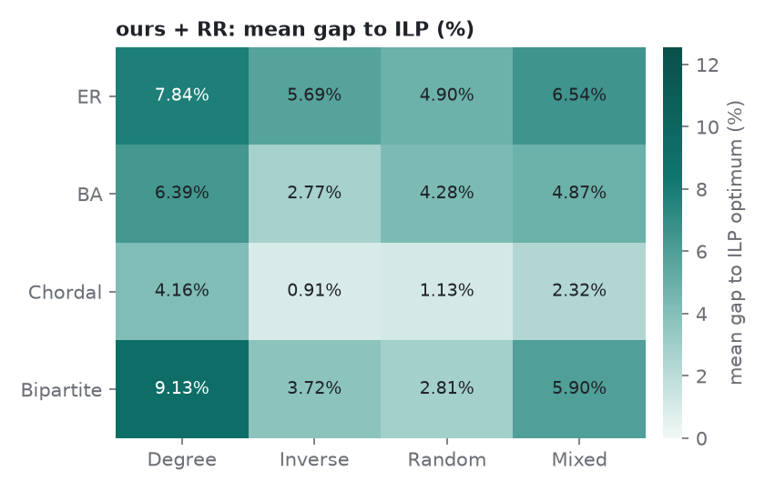 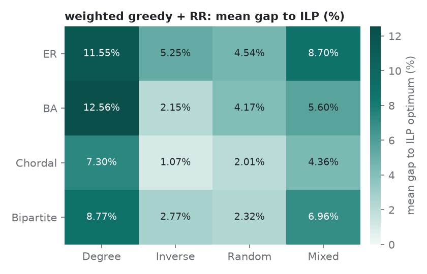

### 7.2 All classes and schemes pooled

| method | mean gap % | optimal found % | mean runtime (s) |
|---|---|---|---|
| weighted_greedy | 8.81 | 22.8 | 0.0004 |
| weighted_greedy_rr | 5.51 | 34.8 | 0.0005 |
| weighted_greedy_rr_ls | 2.76 | 54.8 | 0.0027 |
| wtds_zero_shot+RR | 6.02 ± 0.98 | 29.0 | 0.0875 |
| ours+RR | 4.51 ± 0.89 | 32.5 | 0.0793 |
| ours+RR+LS | 2.24 ± 0.36 | 54.3 | 0.0818 |

### 7.3 Gap vs n per scheme (classes pooled)

| scheme | n | ours+RR gap % | ours+RR+LS gap % | weighted_greedy_rr gap % | wtds_zero_shot+RR gap % | non-proven |
|---|---|---|---|---|---|---|
| Degree | 20 | 6.92 ± 2.76 | 2.87 ± 1.56 | 9.20 | 7.92 ± 2.30 | 0 |
| Degree | 50 | 7.35 ± 1.07 | 5.53 ± 0.65 | 10.57 | 9.25 ± 1.12 | 0 |
| Degree | 100 | 6.89 ± 0.69 | 4.82 ± 0.38 | 11.51 | 9.27 ± 0.11 | 2 |
| Degree | 200 | 5.86 ± 0.19 | 3.49 ± 0.24 | 8.09 | 7.57 ± 1.21 | 10 |
| Inverse | 20 | 1.11 ± 0.39 | 0.08 ± 0.00 | 0.45 | 1.81 ± 0.38 | 0 |
| Inverse | 50 | 3.81 ± 1.01 | 1.34 ± 0.57 | 3.25 | 7.22 ± 0.24 | 0 |
| Inverse | 100 | 3.93 ± 1.06 | 2.02 ± 0.43 | 3.59 | 8.58 ± 3.17 | 0 |
| Inverse | 200 | 4.21 ± 0.14 | 1.79 ± 0.03 | 3.91 | 8.00 ± 0.29 | 1 |
| Random | 20 | 2.61 ± 1.99 | 0.59 ± 0.50 | 3.76 | 4.21 ± 3.01 | 0 |
| Random | 50 | 3.56 ± 0.49 | 1.79 ± 0.11 | 2.59 | 3.25 ± 0.16 | 0 |
| Random | 100 | 3.35 ± 0.00 | 1.59 ± 0.08 | 3.36 | 3.10 ± 1.25 | 0 |
| Random | 200 | 3.60 ± 0.49 | 1.93 ± 0.36 | 3.34 | 3.00 ± 0.18 | 0 |
| Mixed | 20 | 4.98 ± 0.60 | 1.41 ± 0.68 | 6.60 | 5.99 ± 0.08 | 0 |
| Mixed | 50 | 4.93 ± 2.19 | 2.27 ± 0.47 | 7.24 | 6.34 ± 0.65 | 0 |
| Mixed | 100 | 4.90 ± 1.03 | 2.48 ± 0.14 | 6.12 | 5.73 ± 1.29 | 0 |
| Mixed | 200 | 4.67 ± 1.27 | 2.17 ± 0.30 | 5.43 | 5.70 ± 1.13 | 3 |

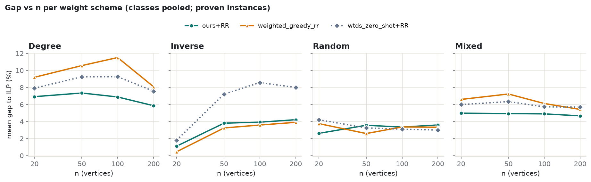

### 7.4 Runtime vs n

| n | weighted_greedy (s) | weighted_greedy_rr (s) | weighted_greedy_rr_ls (s) | wtds_zero_shot+RR (s) | ours+RR (s) | ours+RR+LS (s) | ILP (30 s) (s) |
|---|---|---|---|---|---|---|---|
| 20 | 0.0002 | 0.0002 | 0.0005 | 0.0194 | 0.0193 | 0.0197 | 0.0229 |
| 50 | 0.0003 | 0.0003 | 0.0011 | 0.0545 | 0.0509 | 0.0517 | 0.0371 |
| 100 | 0.0004 | 0.0006 | 0.0026 | 0.0968 | 0.0855 | 0.0875 | 0.8298 |
| 200 | 0.0006 | 0.0009 | 0.0066 | 0.1792 | 0.1617 | 0.1683 | 3.5409 |
| 500 | 0.0016 | 0.0024 | 0.0306 | 0.4163 | 0.3817 | 0.4205 | not run |

Greedy on CPU; GNN rollouts on the GPU (RTX 3050); ILP = CP-SAT, 8 workers, 30 s limit.

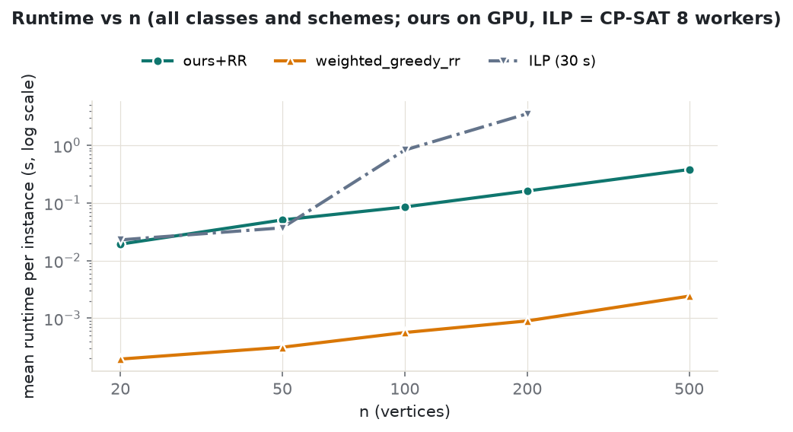

### 7.5 n = 500 (no ILP) and the sub-class sanity check

| class | scheme | n | ours+RR mean W | greedy+RR mean W | ours+RR vs greedy+RR % | ours+RR+LS mean W | greedy+RR+LS mean W | ours+RR time (s) | greedy+RR time (s) |
|---|---|---|---|---|---|---|---|---|---|
| ER | Degree | 500 | 4175.6 ± 2.8 | 4435.7 | -5.86 | 4147.9 ± 8.6 | 4305.4 | 0.471 | 0.0033 |
| ER | Inverse | 500 | 1589.5 ± 10.7 | 1569.4 | +1.28 | 1550.7 ± 0.4 | 1543.8 | 0.453 | 0.0029 |
| ER | Random | 500 | 2580.6 ± 4.2 | 2582.1 | -0.06 | 2543.4 ± 2.5 | 2536.7 | 0.507 | 0.0028 |
| ER | Mixed | 500 | 3221.0 ± 0.6 | 3267.1 | -1.41 | 3183.2 ± 16.9 | 3180.7 | 0.411 | 0.0031 |
| BA | Degree | 500 | 1237.7 ± 6.3 | 1274.7 | -2.91 | 1221.8 ± 4.0 | 1240.2 | 0.403 | 0.0029 |
| BA | Inverse | 500 | 2365.8 ± 0.4 | 2358.9 | +0.29 | 2340.4 ± 0.2 | 2334.2 | 0.259 | 0.0019 |
| BA | Random | 500 | 3229.1 ± 36.0 | 3171.5 | +1.82 | 3191.4 ± 31.5 | 3150.2 | 0.332 | 0.0020 |
| BA | Mixed | 500 | 2597.4 ± 52.5 | 2551.9 | +1.78 | 2538.0 ± 32.2 | 2524.0 | 0.248 | 0.0021 |
| Chordal | Degree | 500 | 3436.6 ± 12.7 | 3436.3 | +0.01 | 3399.7 ± 9.6 | 3394.8 | 0.369 | 0.0024 |
| Chordal | Inverse | 500 | 5622.4 ± 1.1 | 5621.0 | +0.02 | 5618.2 ± 3.5 | 5616.9 | 0.253 | 0.0018 |
| Chordal | Random | 500 | 6875.3 ± 16.5 | 6837.6 | +0.55 | 6840.8 ± 0.7 | 6829.7 | 0.258 | 0.0019 |
| Chordal | Mixed | 500 | 5619.4 ± 0.8 | 5607.5 | +0.21 | 5584.7 ± 4.1 | 5588.7 | 0.239 | 0.0018 |
| Bipartite | Degree | 500 | 4956.0 ± 41.9 | 5092.2 | -2.67 | 4842.7 ± 0.4 | 4920.6 | 0.555 | 0.0028 |
| Bipartite | Inverse | 500 | 1777.2 ± 12.5 | 1772.0 | +0.30 | 1744.3 ± 2.8 | 1749.1 | 0.441 | 0.0021 |
| Bipartite | Random | 500 | 3996.3 ± 20.3 | 3998.0 | -0.04 | 3953.5 ± 14.1 | 3951.8 | 0.494 | 0.0030 |
| Bipartite | Mixed | 500 | 3899.6 ± 44.8 | 3967.6 | -1.72 | 3836.1 ± 24.5 | 3854.2 | 0.414 | 0.0021 |

Negative 'ours vs greedy' = ours is cheaper. Mean ± std over the two model seeds.

Sub-class sanity check (unit interval and convex bipartite; exact polynomial algorithms exist for weighted domination
variants on these subclasses, Lee 2025 — **not** a case for learning, only a check):

| subclass | scheme | n | ours+RR gap % | greedy+RR gap % | proven / ILP runs |
|---|---|---|---|---|---|
| unit interval | Degree | 50 | 8.76 ± 1.55 | 12.25 | 10 / 10 |
| unit interval | Inverse | 50 | 3.91 ± 1.95 | 3.58 | 10 / 10 |
| unit interval | Random | 50 | 0.70 ± 0.14 | 1.55 | 10 / 10 |
| unit interval | Mixed | 50 | 4.69 ± 1.18 | 6.03 | 10 / 10 |
| unit interval | Degree | 100 | 8.40 ± 0.24 | 11.05 | 10 / 10 |
| unit interval | Inverse | 100 | 4.48 ± 0.43 | 3.36 | 10 / 10 |
| unit interval | Random | 100 | 3.43 ± 0.39 | 3.10 | 10 / 10 |
| unit interval | Mixed | 100 | 3.98 ± 0.66 | 7.64 | 10 / 10 |
| convex bipartite | Degree | 50 | 3.74 ± 0.56 | 7.37 | 10 / 10 |
| convex bipartite | Inverse | 50 | 1.02 ± 0.04 | 1.03 | 10 / 10 |
| convex bipartite | Random | 50 | 1.40 ± 0.87 | 0.52 | 10 / 10 |
| convex bipartite | Mixed | 50 | 4.34 ± 0.82 | 5.95 | 10 / 10 |
| convex bipartite | Degree | 100 | 5.17 ± 2.03 | 9.17 | 10 / 10 |
| convex bipartite | Inverse | 100 | 4.60 ± 0.72 | 0.95 | 10 / 10 |
| convex bipartite | Random | 100 | 1.73 ± 1.16 | 0.83 | 10 / 10 |
| convex bipartite | Mixed | 100 | 4.85 ± 2.13 | 4.76 | 10 / 10 |

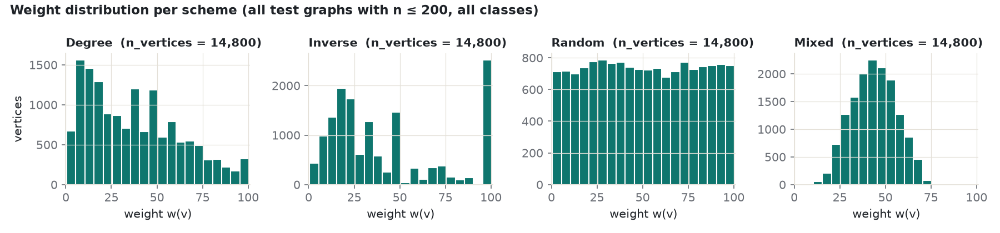

### 7.6 Findings (computed by `scripts/findings.py` from the data above)

1. **Hardest scheme for greedy:** degree. Weighted greedy + RR has a mean gap of 9.94% under degree weights (classes and n = 20, 50, 100, 200 pooled), against 6.36% (mixed), 3.26% (random), 2.79% (inverse). Ours + RR: 6.81% (degree), 4.87% (mixed), 3.28% (random), 3.26% (inverse).
2. **Where ours gains most:** BA / degree (6.39 ± 1.10% vs greedy + RR 12.56%); ER / degree (7.84 ± 1.94% vs greedy + RR 11.55%); Chordal / degree (4.16 ± 0.71% vs greedy + RR 7.30%). Ours + RR has the lower mean gap in 9 of 16 class × scheme cells.
3. **Where greedy is better:** in 7 of 16 cells weighted greedy + RR has the lower mean gap, under degree, inverse, random weights: Bipartite / inverse (3.72% vs 2.77%); BA / inverse (2.77% vs 2.15%); Bipartite / random (2.81% vs 2.32%); ER / inverse (5.69% vs 5.25%); ER / random (4.90% vs 4.54%); Bipartite / degree (9.13% vs 8.77%); BA / random (4.28% vs 4.17%). No mixed-scheme cell is among them.
4. **Fine-tuning helped on the test grid:** mean gap of the copied wtds model + RR 6.02 ± 0.98% → fine-tuned ours + RR 4.51 ± 0.89% (weighted greedy + RR 5.51%). With the same 1 s local search, ours + RR + LS reaches 2.24 ± 0.36% and greedy + RR + LS 2.76%.
5. **Runtime:** at n = 200 ours + RR takes 0.162 s per instance on the GPU, the ILP 3.54 s on average (30 s limit), weighted greedy + RR 0.9 ms. 16 of 640 ILP runs were not proven within 30 s (11 of them on ER graphs); they are excluded from the gaps.
6. **n = 500 (no ILP):** ours + RR is cheaper than weighted greedy + RR in 7 of 16 class × scheme cells. Under degree weights the difference in mean W(S) is -5.86% (ER), -2.91% (BA), +0.01% (Chordal), -2.67% (Bipartite) (negative = ours cheaper).

Files: `results/summary.json`, `results/tables/*.csv` and `*.tex` (LaTeX), `results/figures/*.png`, raw per-instance
rows (with the solution and the graph spec) in `results/raw_grid.csv` and `results/raw_subclass.csv`.
<!-- RESULTS:end -->

<!-- EXACT:begin -->
## Cross-check against exact algorithms

Four graph classes on which the minimum-weight TDS can be computed exactly. Our method is compared with the exact
optimum on 240 new test graphs: 4 classes × n ∈ {20, 50, 100, 200, 500, 1000} × 10 graphs. The graph and
weight seeds come from the test range and none of them was used by an earlier run. Each graph is solved under 5
weightings: unit, degree, inverse, random and mixed. That gives 7,800 solutions, all of them
checked with `is_total_dominating_set` and with W(S) recomputed (`results/exact_vs_ours.csv`).

**Exact methods** (`wtdsws/baselines/exact_special.py`). All of them return a minimum-weight set and, among the
minimum-weight sets, a smallest one.

| class | exact method | reference |
|---|---|---|
| Trees (5 random labelled trees + 5 BA with m = 1 per n) | linear-time rooted DP, 4 states per vertex | Laskar, Pfaff, Hedetniemi & Hedetniemi (1984), SIAM J. Algebraic Discrete Methods 5(3); weighted version = standard DP |
| Unit-interval | **our exact DP for unit-interval graphs** over the sorted interval model ([docs/exact_interval.md](docs/exact_interval.md)) | exact polynomial algorithms for interval graphs: Bertossi & Gori (1988), SIAM J. Discrete Math. 1(3); Chang (1998), SIAM J. Computing 27(6). These were not reproduced |
| Convex bipartite | Exact (ILP): CP-SAT, 60 s, proven-optimal only | polynomial algorithms exist (Lee 2025, Mathematics 13(3):403) |
| 2-trees | Exact (ILP): CP-SAT, 60 s, proven-optimal only | polynomial via bounded treewidth |

**Validation** (`tests/test_exact_special.py`, `results/exact_validation.json`; this passed before any plot was
made):
* tree DP vs brute force: 500 instances (n ≤ 12, all 5 weightings),
  0 weight / 0 size mismatches;
  unit-interval DP vs brute force: 500 instances,
  0 / 0 mismatches.
* tree DP vs proven-optimal CP-SAT: 300 instances (n = 50–200),
  0 / 0 mismatches; unit-interval DP:
  300 instances, 0 / 0 mismatches
  (0 unproven).
* In the main run, the same ILP also runs on every tree and unit-interval graph: 600/600 proven,
  and 600/600 agree with the DP on (W, |S|).
* Exact ILP optima not proven within 60 s (convex bipartite, 2-trees): **0**. An unproven
  instance would be drawn as a hollow marker.

**Methods:** Exact; ours = GNN+RL + redundancy removal, averaged over both checkpoints (`checkpoints/best.pt`,
`checkpoints/seed1_best.pt`); weighted greedy + RR. Ours + RR + 1 s local search appears only in the table.

### Plot 1 · Cardinality |S|, unit weights (the fair cardinality comparison)
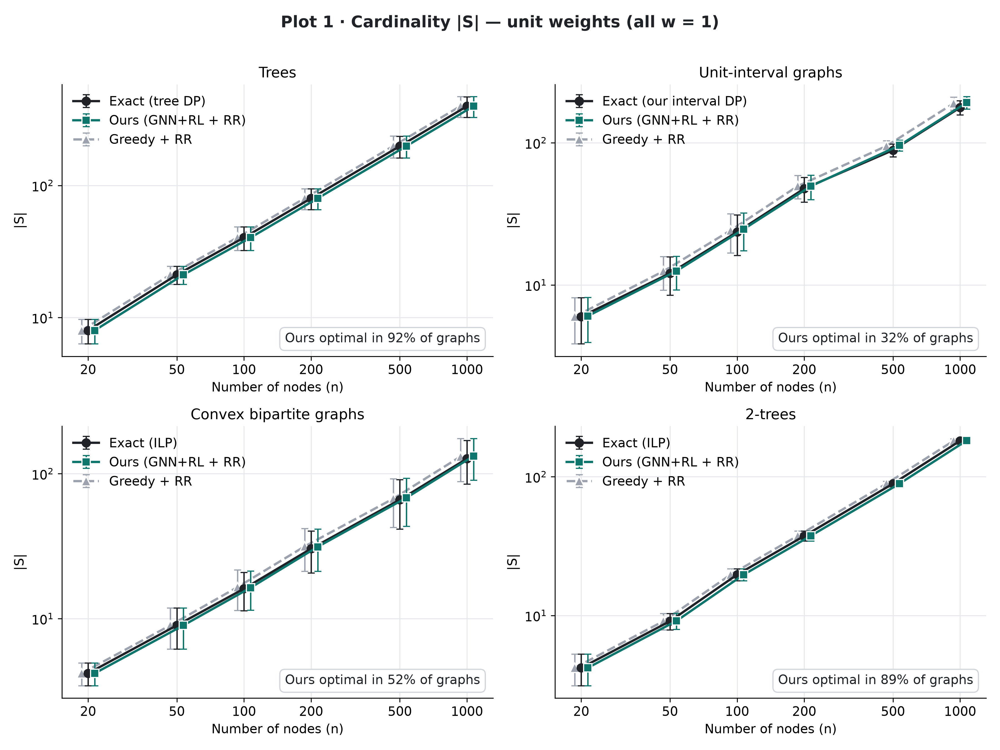

### Plot 2 · Cardinality |S|, weighted graphs (random scheme shown; degree / inverse / mixed in the same folder)
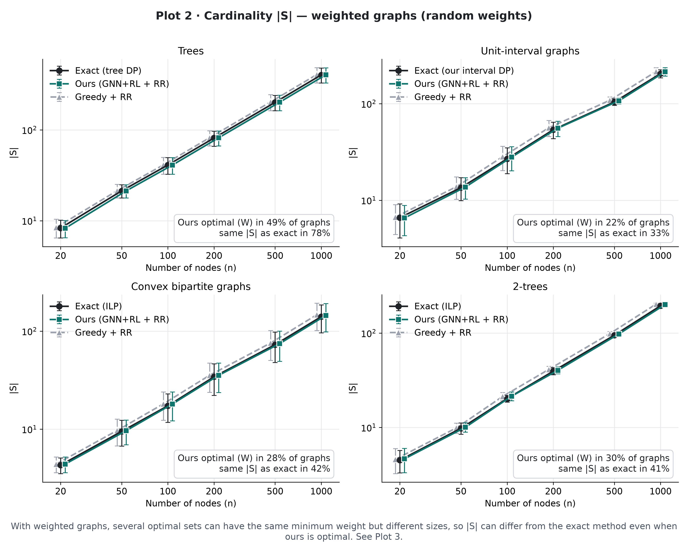

*With weighted graphs, several optimal sets can have the same minimum weight but different sizes, so |S| can differ
from the exact method even when ours is optimal. See Plot 3.* Example (`tests/test_exact_special.py`, verified by
brute force): the path 1–2–3–4–5 with weights {1:3, 2:4, 3:4, 4:1, 5:1} has minimum weight 9, attained by two
optimal sets, **{2,3,4}** (3 vertices) and **{1,2,4,5}** (4 vertices).

### Plot 3 · Total weight W(S), weighted graphs (the objective our system minimises)
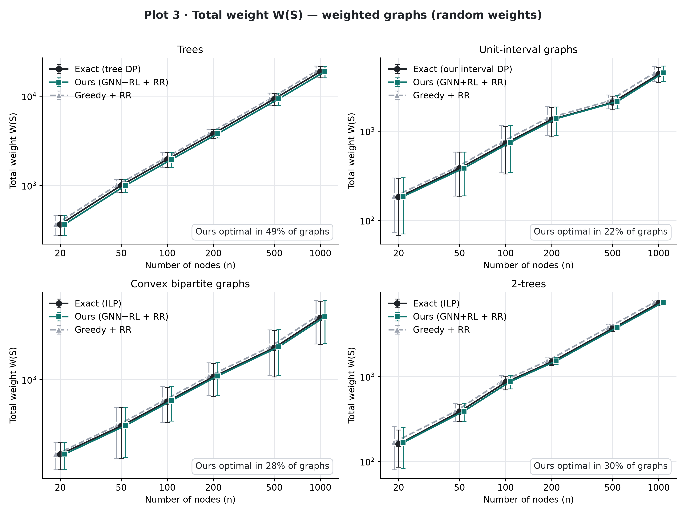

Paper figure (3 rows: Plot 1 / Plot 2 / Plot 3 with the random scheme × 4 classes):
`results/figures/exact_vs_ours/combined_paper_figure.png/.pdf`. All figures are 300-dpi PNG plus vector PDF.

### n = 100 and n = 1000 (mean over 10 graphs; ours = mean of 2 seeds)
**n = 100**

| class | \|S\| exact (unit) | \|S\| ours (unit) | W exact (random) | W ours (random) | gap W % (random) | ours optimal % (random) |
|---|---|---|---|---|---|---|
| Trees | 40.3 | 40.30 | 1959.6 | 1964.45 | 0.24 | 55 |
| Unit-interval | 23.6 | 24.70 | 730.1 | 747.50 | 2.45 | 25 |
| Convex bipartite | 16.1 | 16.35 | 606.1 | 618.90 | 3.34 | 20 |
| 2-trees | 19.7 | 19.70 | 854.5 | 870.70 | 1.98 | 30 |

**n = 1000**

| class | \|S\| exact (unit) | \|S\| ours (unit) | W exact (random) | W ours (random) | gap W % (random) | ours optimal % (random) |
|---|---|---|---|---|---|---|
| Trees | 397.4 | 397.80 | 18841.5 | 18882.15 | 0.21 | 0 |
| Unit-interval | 176.8 | 191.60 | 4348.9 | 4493.00 | 3.29 | 0 |
| Convex bipartite | 127.0 | 132.40 | 4132.7 | 4219.60 | 2.29 | 0 |
| 2-trees | 181.3 | 182.15 | 7350.2 | 7505.40 | 2.11 | 0 |

### Share of runs where ours reaches the exact optimum (%; all n, graph × model seed)
| class | ours + RR, unit | ours + RR, weighted (W) | same \|S\| as exact, weighted | ours + RR + LS, unit | ours + RR + LS, weighted | greedy + RR, unit | greedy + RR, weighted | mean gap % ours (unit / weighted) | mean gap % greedy (unit / weighted) |
|---|---|---|---|---|---|---|---|---|---|
| Trees | 92 | 59 | 79 | 97 | 85 | 87 | 71 | 0.03 / 0.19 | 0.06 / 0.23 |
| Unit-interval | 32 | 18 | 29 | 46 | 31 | 35 | 18 | 5.36 / 4.88 | 4.31 / 6.01 |
| Convex bipartite | 52 | 24 | 37 | 69 | 53 | 55 | 33 | 2.10 / 3.43 | 1.83 / 3.41 |
| 2-trees | 89 | 38 | 55 | 96 | 65 | 97 | 39 | 0.23 / 1.90 | 0.05 / 2.59 |

Full table per class × scheme × n: `results/tables/exact_vs_ours.csv` / `.tex`. App page: **Exact vs ours**.

### Observations (generated from the data by `scripts/readme_exact.py`)
* With unit weights, ours + RR reaches the exact optimum most often on trees (92% of graph × seed runs) and least often on unit-interval (32%).
* On weighted graphs (all classes and schemes pooled), ours + RR is weight-optimal in 56% of runs for n ≤ 100 and in 10% for n ≥ 500. The mean gap in W is 2.03% for n ≤ 100 and 3.44% for n ≥ 500. Exact optima become rarer for ours as n grows, while the relative gap stays below 5% on average.
* Mean gap vs weighted greedy + RR (unit weights): ours is lower on Trees and higher on Unit-interval, Convex bipartite, 2-trees.
* Mean gap vs weighted greedy + RR (the four weight schemes): ours is lower on Trees, Unit-interval, 2-trees and higher on Convex bipartite.
* Adding 1 s of local search raises the share of weight-optimal runs on weighted graphs by 14–29 percentage points, depending on the class (table only, not plotted).
* Classes where, on weighted graphs, ours has the same |S| as exact more often than the same W: Trees, Unit-interval, Convex bipartite, 2-trees. Equal size does not mean optimal, so Plot 3 (W), not Plot 2 (|S|), measures the objective.

### Reproduce
```bash
python scripts/validate_exact.py        # exact methods vs brute force and proven ILP -> results/exact_validation.json
python scripts/exact_vs_ours.py         # 240 graphs x 5 weightings, all methods   -> results/exact_vs_ours.csv
python scripts/plot_exact_vs_ours.py    # figures, tables, summary (refuses to run if validation failed)
python scripts/readme_exact.py          # this section
```
<!-- EXACT:end -->

<!-- EXACT-FINAL:begin -->
## Exact vs ours: pilot → choose → fresh test (updated plots)

The first exact-vs-ours run (previous section) mixed tree families and averaged densities, so the three methods
often overlapped on the plots. To show where they **do** differ, without selection bias, we used three steps:

1. **Pilot sweep** (`scripts/pilot_sweep.py`). The graphs come from a separate **pilot seed range**
   `SEED_RANGES["pilot"] = [1.4e9, 1.5e9)`, which is disjoint from train / val / test
   (`tests/test_ws_schemes.py::test_pilot_seed_range_disjoint`). We tried 9 class parameters: trees (random labelled
   vs BA m = 1), unit-interval and convex bipartite (average degree 3 / 6 / 10), and 2-trees. Each was run on two
   n grids, A = 100…1000 and B = 200…2000, with 5 graphs per n and 5 weightings. That gives
   653 graphs and 3,265 instances; 59 exact optima were not
   proven. Methods: exact, ours + RR (best.pt) and greedy + RR. All results:
   `results/pilot_sweep.csv` (every instance), `pilot_sweep_per_graph.csv`, `pilot_sweep_settings.csv`,
   `pilot_sweep_choice.csv`.
2. **Choose by rule** (`scripts/pilot_choose.py`, `results/chosen_settings.json`). SEPARATION = greedy gap % −
   ours gap % (vs the exact optimum). For each class we chose the (parameter, grid) with the largest mean separation,
   among the candidates where ours was always valid and the exact optimum was proven on ≥ 95% of instances. Plots 2–5
   use the non-unit weighting with the largest separation for that class.
3. **Fresh test** (`scripts/exact_vs_ours_final.py`). New graphs drawn from the **test** seed range, 10 per n (pilot
   graphs are never reused; this is asserted). 400 graphs × 5 weightings, 13,000
   solutions, all checked with `is_total_dominating_set` and W(S) recomputed. Exact optima not proven:
   **0**. DP vs ILP cross-check: 1000/1000 agree.

The choice in step 2 was made to show differences, so the pilot separations are optimistic. Only the fresh-test
numbers below are results.

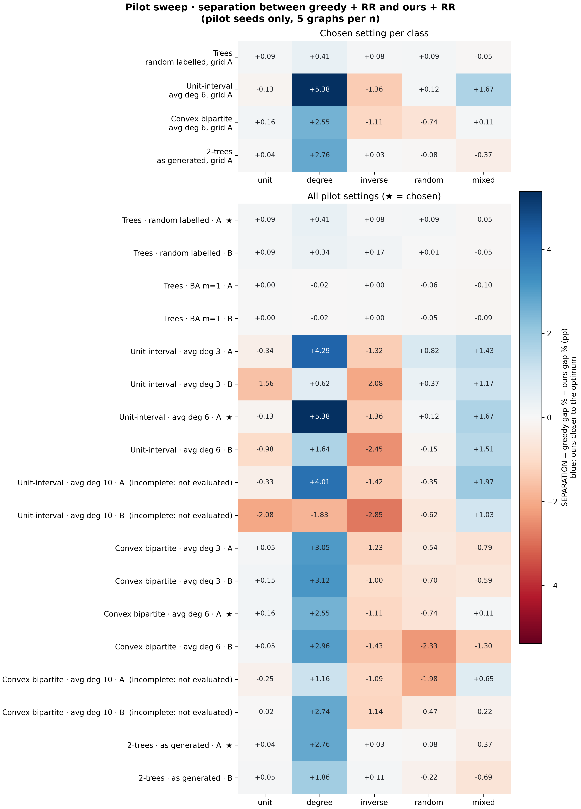

### Chosen settings (from the pilot)
| class | parameter | n grid | separation, all weightings (pp) | weighting for Plots 2–5 | separation, that weighting (pp) | exact proven (pilot) | runner-up |
|---|---|---|---|---|---|---|---|
| Trees | random labelled tree | A (100–1000) | +0.12 | degree | +0.41 | 100% | random labelled tree, grid B (+0.11) |
| Unit-interval | average degree 6 | A (100–1000) | +1.14 | degree | +5.38 | 100% | average degree 3, grid A (+0.98) |
| Convex bipartite | average degree 6 | A (100–1000) | +0.17 | degree | +2.55 | 99% | average degree 3, grid B (+0.10) |
| 2-trees | as generated (k = 2) | A (100–1000) | +0.48 | degree | +2.76 | 100% | as generated (k = 2), grid B (+0.22) |

### Plots (fresh test graphs; ours = mean of 2 checkpoints, error bars = std over graphs)
Plot 1 · |S|, unit weights
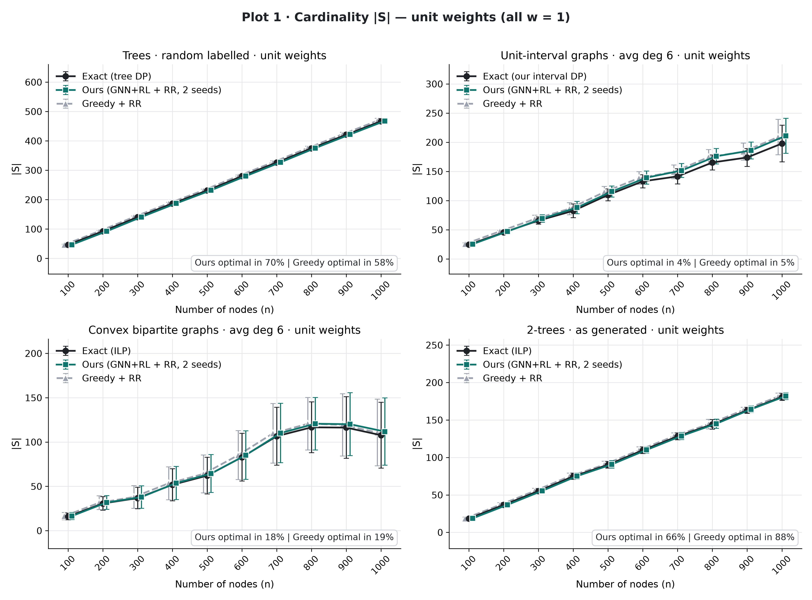

Plot 2 · |S|, chosen weighting. *With weighted graphs, several optimal sets can have the same weight but different
sizes, so |S| can differ even when ours is optimal (see Plots 3–5).*
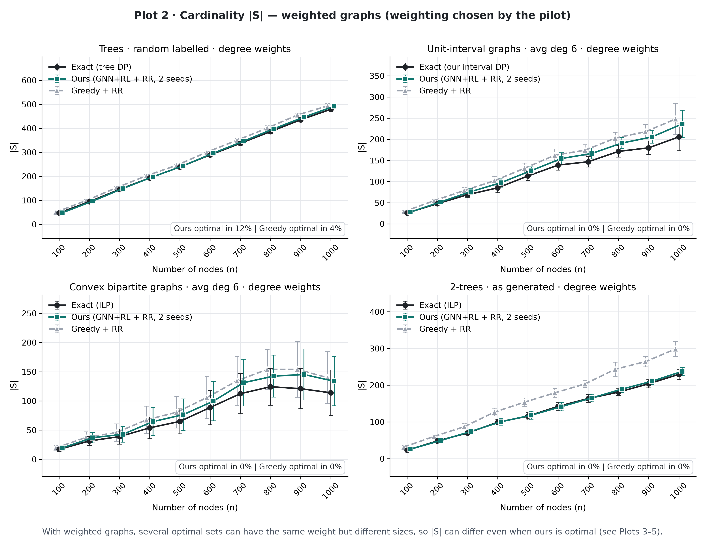

Plot 3 · W(S), chosen weighting
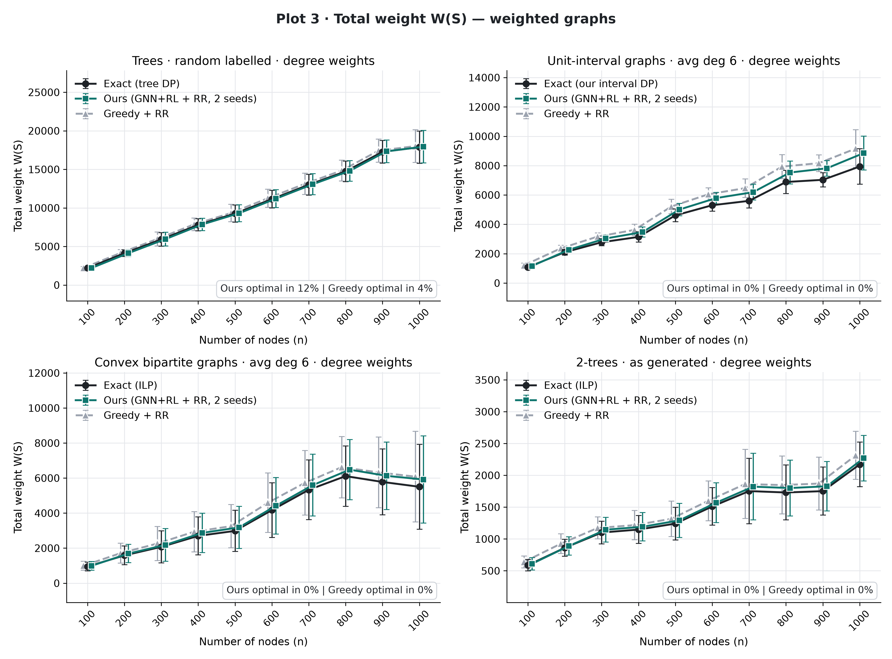

Plot 4 (extra cost W(S) − W_exact) is archived: `results/figures/archive/final_plot4_extra_cost_chosen.png/.pdf`.

Plot 5 · Approximation ratio W(S) / W_exact
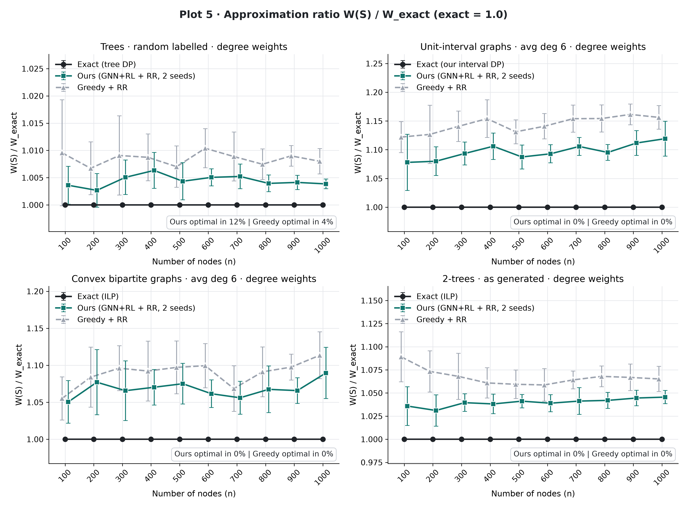

**Paper figures** (`scripts/plot_paper.py`, redrawn from the same CSV): `results/figures/paper/` with
plot1_cardinality_unit, plot2_cardinality_weighted, plot3_total_weight, plot5_ratio and **paper_main** (rows Plot 1 /
Plot 3 / Plot 5, columns the classes). Each panel states "Ours beats Greedy in X% of graphs": the share of
(graph, checkpoint) pairs, over all n, where ours + RR is strictly better than greedy + RR (|S| for unit weights,
W(S) otherwise), with ties reported separately and X rounded down. Paper table: `results/tables/paper_table.tex`.

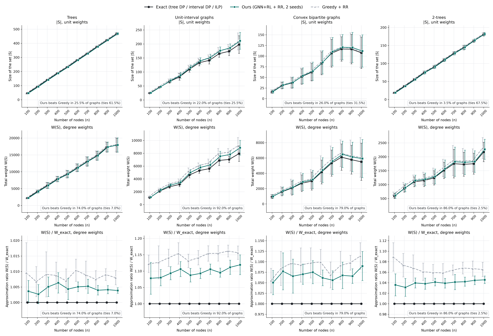

### Largest n per class (chosen weighting; mean over 10 fresh graphs)
| class | weighting | n | W exact | W ours | W greedy | gap ours % | gap greedy % | ours optimal % | greedy optimal % | ours + LS gap % |
|---|---|---|---|---|---|---|---|---|---|---|
| Trees | degree | 1000 | 17869.9 | 17938.7 | 18014.8 | 0.39 | 0.80 | 0 | 0 | 0.15 |
| Unit-interval | degree | 1000 | 7938.4 | 8852.5 | 9161.3 | 11.92 | 15.63 | 0 | 0 | 6.98 |
| Convex bipartite | degree | 1000 | 5502.2 | 5917.6 | 6078.7 | 8.96 | 11.35 | 0 | 0 | 2.66 |
| 2-trees | degree | 1000 | 2171.1 | 2268.7 | 2313.4 | 4.55 | 6.52 | 0 | 0 | 3.30 |

### All n pooled
| class | weighting | gap ours / greedy % (chosen) | separation (pp) | optimal % ours / greedy (chosen) | graphs ours better / greedy better | gap ours / greedy % (unit) | optimal % ours / greedy (unit) |
|---|---|---|---|---|---|---|---|
| Trees | degree | 0.44 / 0.85 | +0.41 | 12 / 4 | 81 / 16 (of 100) | 0.14 / 0.21 | 70 / 58 |
| Unit-interval | degree | 9.69 / 14.41 | +4.72 | 0 / 0 | 96 / 4 (of 100) | 5.78 / 4.92 | 4 / 5 |
| Convex bipartite | degree | 6.79 / 8.94 | +2.16 | 0 / 0 | 78 / 22 (of 100) | 3.41 / 2.83 | 18 / 19 |
| 2-trees | degree | 3.98 / 6.73 | +2.75 | 0 / 0 | 89 / 9 (of 100) | 0.53 / 0.11 | 66 / 88 |

Full table (every class × weighting × n, with ratios, ours + RR + LS and runtimes):
`results/tables/exact_vs_ours_final.csv` / `.tex`.

### Observations (generated from the data by `scripts/readme_exact_final.py`)
* With the chosen weighting, pooled over all n of the fresh test graphs, ours + RR has a smaller mean gap than greedy + RR on Trees, Unit-interval, Convex bipartite, 2-trees.
* With unit weights (Plot 1), greedy + RR has the smaller mean gap on Unit-interval, Convex bipartite, 2-trees; ours has the smaller or equal gap on Trees.
* Trees: the pilot separation for the chosen weighting was +0.41 pp; on the fresh test graphs it is +0.41 pp (same sign).
* Unit-interval: the pilot separation for the chosen weighting was +5.38 pp; on the fresh test graphs it is +4.72 pp (same sign).
* Convex bipartite: the pilot separation for the chosen weighting was +2.55 pp; on the fresh test graphs it is +2.16 pp (same sign).
* 2-trees: the pilot separation for the chosen weighting was +2.76 pp; on the fresh test graphs it is +2.75 pp (same sign).
* Ours + RR + 1 s local search (table only) has a smaller mean gap than greedy + RR on Trees, Unit-interval, Convex bipartite, 2-trees.

### Stress test
**Stress test (adversarial for greedy). Separate from the results above and never mixed into them.** "spider trees": h = max(1, n // 400) hubs on a path; the other vertices form legs (paths) of length
U{2..5}, each attached to a random hub. Degree weights make the hubs expensive (w = 100) and leg vertices cheap. Degree weights, 10 test-range graphs per n, 350 checked solutions; DP vs ILP cross-check 50/50.

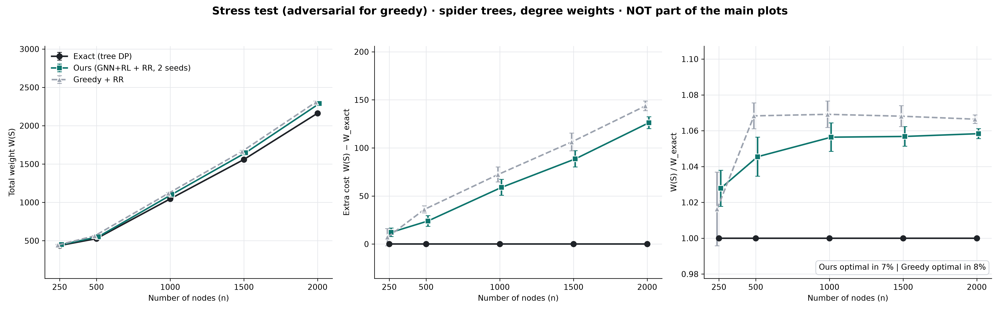

| n | W exact | gap ours % | gap ours + LS % | gap greedy % | ours optimal % | greedy optimal % |
|---|---|---|---|---|---|---|
| 250 | 436.8 | 2.78 | 0.00 | 1.63 | 25 | 40 |
| 500 | 527.5 | 4.55 | 0.00 | 6.83 | 10 | 0 |
| 1000 | 1045.5 | 5.64 | 0.00 | 6.91 | 0 | 0 |
| 1500 | 1559.3 | 5.68 | 1.01 | 6.81 | 0 | 0 |
| 2000 | 2163.0 | 5.83 | 1.91 | 6.64 | 0 | 0 |

### Reproduce
```bash
python scripts/pilot_sweep.py           # pilot seeds only -> results/pilot_sweep.csv
python scripts/pilot_choose.py          # rule-based choice -> results/chosen_settings.json + heatmap
python scripts/exact_vs_ours_final.py   # fresh test graphs -> results/exact_vs_ours_final.csv
python scripts/plot_exact_vs_ours_final.py
python scripts/stress_test.py           # optional, separate figure
python scripts/readme_exact_final.py    # this section
```
<!-- EXACT-FINAL:end -->

## 8. The system

### Install

```bash
cd "D:\project s7\wtds-ws-gnn-rl"
python -m venv .venv
.venv\Scripts\python -m pip install torch==2.11.0 --index-url https://download.pytorch.org/whl/cu128
.venv\Scripts\python -m pip install -r requirements.txt      # exact versions: requirements-lock.txt
```

### App

```bash
.venv\Scripts\python -m streamlit run app/streamlit_app.py
```

Five pages, in the same design system as the wtds app (off-white `#F7F5F0`, white cards with a `#E4E0D8` border, teal
`#0F766E` selected vertices, amber `#D97706` highlights, Fraunces / Inter / JetBrains Mono, Streamlit chrome hidden):

1. **Solve** — input by example (the hand examples of Section 9), generator (class → subtype, size, density, seed),
   upload (edges + optional weights) or paste; a **weight-scheme selector** (Degree / Inverse degree / Random / Mixed /
   Custom) with the formula, its real-world meaning and a histogram of the assigned weights; methods GNN + RL (ours),
   weighted greedy, greedy + RR, exact ILP (disabled above 300 vertices). The graph shows weights on the nodes,
   selected vertices in teal; hovering shows weight, degree, membership and which selected vertex covers it. Stat
   cards: W(S), |S|, gap % (when the ILP proves the optimum, n ≤ 150), runtime, validity.
2. **Same graph, 4 schemes** — ours (+ ILP when n ≤ 150) on one graph under all four schemes side by side, with the
   number of hubs (degree ≥ 90th percentile) in S. Buttons "Two triangles: degree vs inverse", "House: degree vs inverse".
3. **Compare methods** — every method on the current graph and scheme: table + bar chart.
4. **Results** — model card, class × scheme heatmaps, tables and figures of Section 7, read from `results/`;
   "Experiment pending" when a file is missing.
5. **How it works** — pipeline, the four formulas and meanings, the four classes, what changed, citations.

The model is cached with `st.cache_resource` and runs on the GPU when available (CPU otherwise). Bad files, self-loops
(dropped, with a warning), duplicate edges, arbitrary labels, disconnected graphs, isolated vertices (friendly error)
and non-positive weights are handled. Screenshots from a browser run (`scripts/screenshots.py`) are in
`docs/screenshots/`.

### CLI

```bash
python -m wtdsws.solve --graph edges.txt --scheme inverse --seed 0 --method rl --out solution.json --plot solution.png
python -m wtdsws.solve --graph edges.txt --weights weights.txt --method ilp     # custom weights ('vertex weight' per line)
```

Methods: `rl` (ours), `greedy`, `greedy_rr`, `greedy_rr_ls`, `wtds_zero_shot`, `rl_exact`, `ilp`.

### Tests

```bash
.venv\Scripts\python -m pytest -q
```

<!-- TESTS:begin -->
Final run: **708 passed** (`logs/pytest_final.log`). The suite covers: the four schemes (range,
determinism, monotonicity, the max/min vertex gets 100, mixed = rounded mean), the ten exact hand examples of Section 9
against brute force, 500 generated graphs per class (class assertion, convexity, no isolated vertex), weighted ILP =
brute force on 200 graphs (n ≤ 10, all classes × schemes), every solver valid on 300 graphs, strict loading of both
copied checkpoints, isolated-vertex and bad-weight errors, the CLI, all copied wtds tests (renamed package), and the
app end to end (every hand example under degree and inverse, one generated graph per class × scheme at n = 100, an
isolated vertex, bad weights, custom weights, a 5,000-vertex BA graph without drawing, the 4-schemes presets and
every other page).
<!-- TESTS:end -->

## 9. Hand examples (verified by brute force; `tests/test_ws_schemes.py`)

| Graph | degree weights → optimum | inverse weights → optimum |
|---|---|---|
| House (1-2, 2-3, 3-4, 4-1, 1-5, 2-5) | {1:100, 2:100, 3:67, 4:67, 5:67} → W* = 167, S = {1,4} or {2,3} | {1:67, 2:67, 3:100, 4:100, 5:100} → W* = 134, unique S = {1,2} |
| Path 1-2-3-4 | {1:50, 2:100, 3:100, 4:50} → W* = 200, S = {2,3} | {1:100, 2:50, 3:50, 4:100} → W* = 100, S = {2,3} (forced) |
| Star, centre 0, leaves 1..5 | {0:100, leaves:20} → W* = 120, S = {0, any leaf} | {0:20, leaves:100} → W* = 120, S = {0, any leaf} |
| Two triangles + bridge 3-4 | {1,2,5,6:67; 3,4:100} → W* = 200, unique S = {3,4} | {1,2,5,6:100; 3,4:67} → W* = 134, unique S = {3,4} |
| Kite (1-2, 1-3, 1-4, 1-5, 2-3, 4-5, 5-6, 6-7) | {1:100, 2:50, 3:50, 4:50, 5:75, 6:50, 7:25} → W* = 225 (5 optimal sets, e.g. {1,5,6}) | {1:25, 2:50, 3:50, 4:50, 5:34, 6:50, 7:100} → W* = 109, unique S = {1,5,6} |

<!-- LIMITATIONS:begin -->
## 10. Limitations

* **Short fine-tuning:** 78,000 steps per seed (about 20 minutes each on an RTX 3050), with a 20k
  replay buffer because of low free RAM. Longer training might change the picture.
* **Two seeds** only; the ± values are the spread of two runs, not a confidence interval.
* **ILP ground truth only up to n = 200** (30 s limit): 16 of 640 ILP runs were
  not proven and are excluded from the gaps; at n = 500 only the weights of the heuristics are compared.
* **The gain is not uniform:** weighted greedy + RR has the lower gap in several class × scheme cells (Section 7.6),
  mostly under inverse and random weights. Greedy is also two orders of magnitude faster than the GNN rollout.
* **The schemes are synthetic models of real costs** (load, infrastructure, site cost); real deployments may combine
  costs differently. Custom weights are supported for that case.
* Runtimes were measured on a laptop with a background disk job (the requested re-hash) running during part of the
  evaluation.
* On unit-interval and convex-bipartite graphs exact polynomial algorithms exist for related weighted domination
  problems (Lee 2025); results there are a sanity check, not an argument for learning.

## Reproducing the results

```bash
python scripts/make_val_set.py                                   # 160 validation graphs + proven ILP optima (data/)
python scripts/zero_shot.py                                      # zero-shot gaps of the copied wtds checkpoints
python -m wtdsws.train --config configs/ws_finetune.yaml --seed 0         # 20-min box (GPU)
python -m wtdsws.train --config configs/ws_finetune_seed1.yaml --seed 1   # stops at seed 0's step count
python scripts/finalize_models.py                                # best.pt per seed -> checkpoints/, model_info.json
python scripts/run_eval.py --part grid                           # class x scheme x n (+ n = 500), ~20 min
python scripts/run_eval.py --part subclass                       # unit interval + convex bipartite
python scripts/findings.py && python scripts/analyze.py          # re-verify every solution, tables, figures
python scripts/readme_results.py                                 # fill the generated README sections
python -m pytest -q > logs/pytest_final.log
python -B scripts/hash_tree.py docs/original_hashes_after.txt "../tds-gnn-rl" "../wtds-gnn-rl" "../ewtds-gnn-rl"
```

The old projects (`tds-gnn-rl`, `wtds-gnn-rl`, `ewtds-gnn-rl`) were only read and copied from: the SHA-256 hashes of
all their files before (`docs/original_hashes_before.txt`) and after (`docs/original_hashes_after.txt`) the build are
identical.
<!-- LIMITATIONS:end -->

## References

* M. Chen, S. Liu, W. He (2024). *Learn to solve dominating set problem with GNN and reinforcement learning.* Applied
  Mathematics and Computation 474:128717. (Base paper; `D:\project s7\base paper.pdf`.)
* C.-M. Lee (2025). *Exploring Dominating Functions and Their Complexity in Subclasses of Weighted Chordal Graphs and
  Bipartite Graphs.* Mathematics 13(3):403. doi:10.3390/math13030403.
* R. Laskar, J. Pfaff, S. M. Hedetniemi, S. T. Hedetniemi (1984). *On the algorithmic complexity of total
  domination.* SIAM J. Algebraic Discrete Methods 5:420–425.
